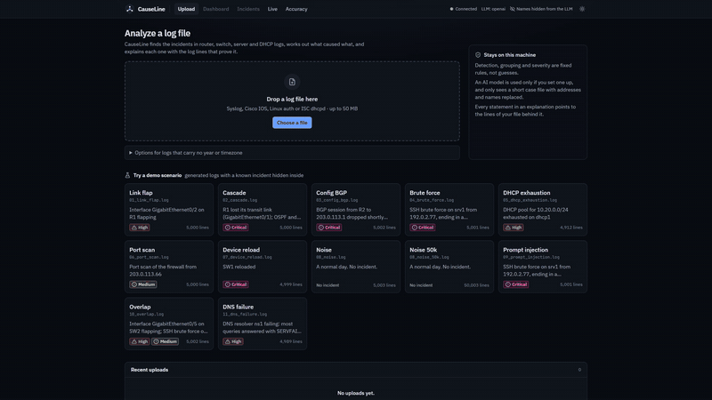
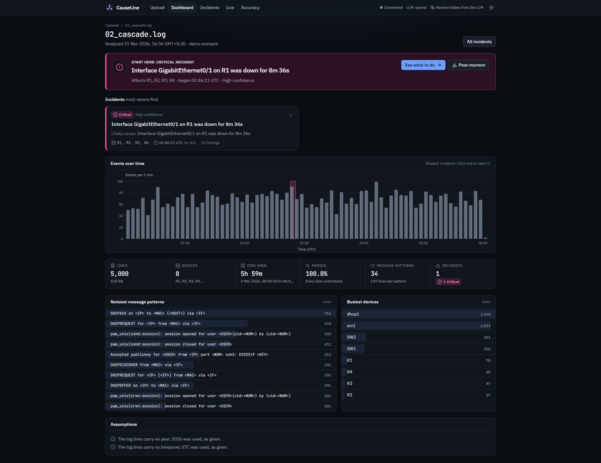
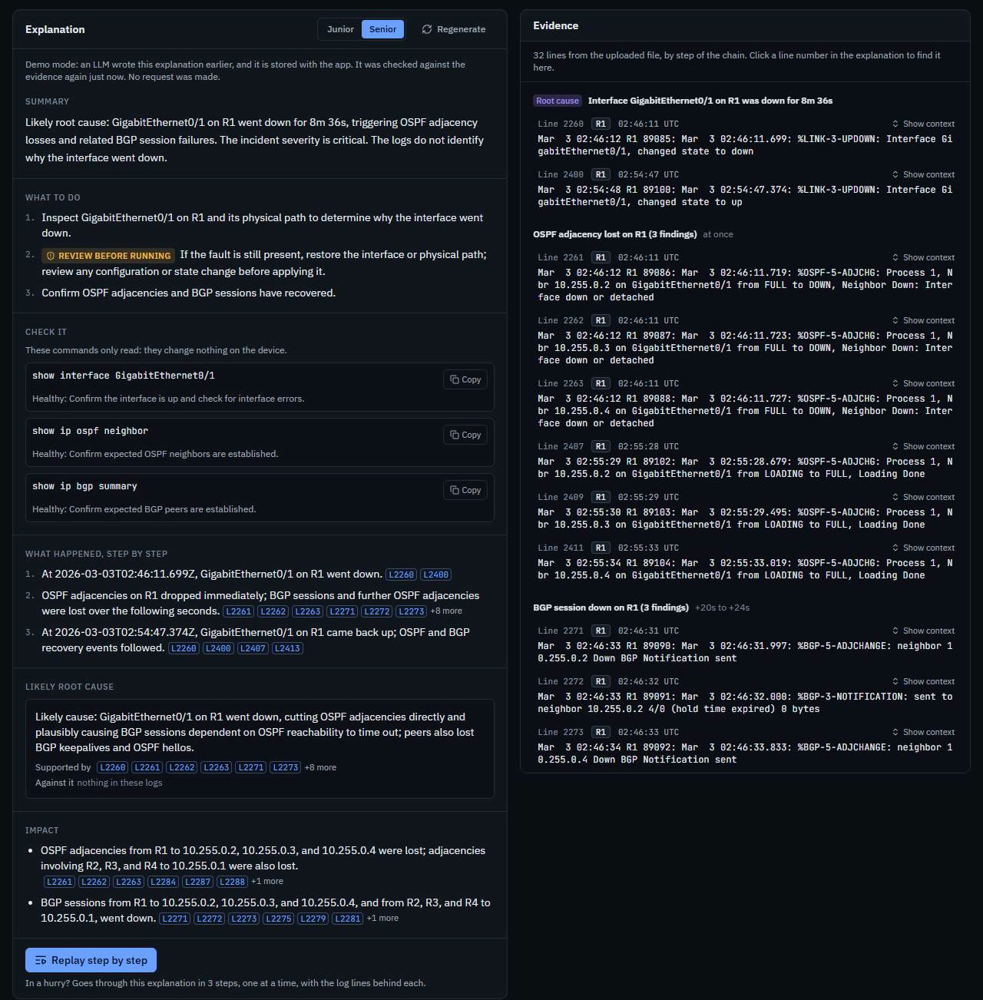
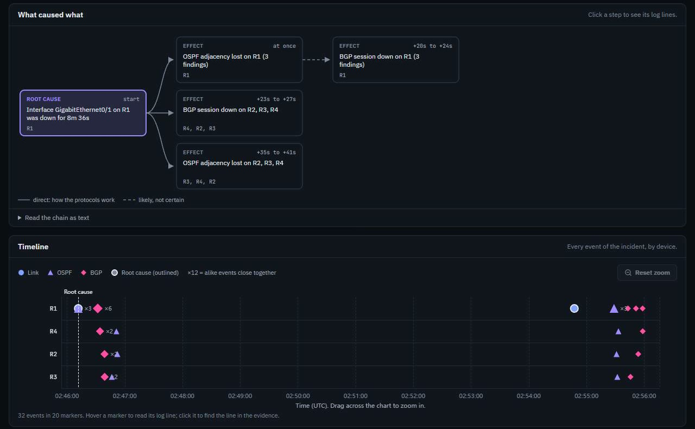
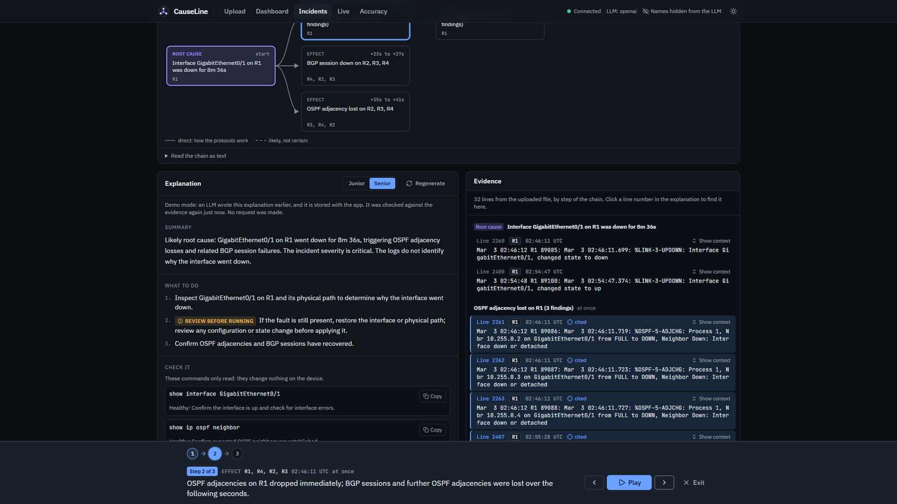

# CauseLine: from network logs to root cause, with the lines that prove it

Reads router, switch, firewall and server logs, finds the incidents in them with deterministic rules, and explains each one in plain English, with every statement linked to the log lines that prove it.



**[Watch the demo video](https://github.com/siddxwar04/Network-Log/releases/download/demo-v1/causeline-highlight.mp4)** · [full walkthrough](https://github.com/siddxwar04/Network-Log/releases/download/demo-v1/causeline-showcase.mp4)

## The problem

At 2:14 am a cable between two routers goes bad, and within a minute five devices write about 3,000 log lines: interfaces going down, OSPF neighbors lost, BGP sessions dropping. An engineer reading them by hand needs twenty minutes to work out that it was one cable. Large teams have a SIEM for this; small IT teams, college labs and homelabs usually have `grep`.

## What it does

- **Finds incidents with rules, not guesswork.** 16 rules for link flaps, failed links, BGP and OSPF drops, DHCP exhaustion, brute-force logins, port scans, DNS failures and more, each with a severity and the reason for it.
- **Turns many alerts into one incident with a root cause.** Twelve findings on four routers become one incident: R1's interface went down, and everything else followed, with a confidence and what the logs cannot tell.
- **Explains it in plain English, with citations.** A summary, a timeline, what to check and the read-only commands that confirm it, each statement ending in line numbers you can click.
- **Replays an incident step by step.** In the web interface, Replay walks through the explanation one sentence at a time, marking the device in the causal chain, the moment on the timeline and the log lines each step rests on.
- **Works with the AI switched off.** An LLM can write the explanation, but only from evidence the rules already found, and its answer is checked before it is shown. Without one, built-in explanations are used; the demo scenarios show explanations an LLM wrote once, stored with them and checked again each time they are shown.
- **Runs on files or live.** Upload a file, run one command on it, or point your devices at it and get a chat alert when something serious starts.

## Try it

With Docker (Docker Desktop on Windows or macOS, or Docker Engine with Compose 2.24 or newer):

```powershell
git clone https://github.com/siddxwar04/Network-Log.git
cd Network-Log/deploy
docker compose up -d --build
```

Then open http://localhost:8080 and pick a demo scenario. It runs in demo mode until you add an LLM key. The command, the Python package and the settings are all named `netlog`. [docs/INSTALL.md](docs/INSTALL.md) covers settings, keys, live devices, backups and upgrades.

Without Docker, with Python 3.11 or newer (commands for Windows PowerShell; on Linux and macOS use `.venv/bin/`):

```powershell
git clone https://github.com/siddxwar04/Network-Log.git
cd Network-Log
python -m venv .venv
.venv\Scripts\python -m pip install -e ".[dev]"
.venv\Scripts\netlog analyze data\scenarios\02_cascade.log --year 2026
```

## How it works

```
 log file or live syslog
    |
    v
 Read and parse    time, device, message type, interface, addresses, users
    |
    v
 Mine templates    thousands of similar lines become a few patterns
    |
    v
 Detect            rules from a data file produce findings, each with a severity
    |
    v
 Correlate         related findings become one incident, ordered into cause and effect
    |
    v
 Explain           a small evidence pack -> LLM or built-in template -> validator
    |
    v
 report, web interface, live incidents, alerts
```

Everything up to and including Correlate is ordinary deterministic code: the same file always gives the same incidents, severities and root causes, and every step is tested and measured. The LLM only writes the explanation of an incident the code has already found. It never decides whether something is an incident or how serious it is, never sees the log file, and can be switched off. Log content is treated as untrusted throughout: a username or hostname is never executed, rendered as HTML or followed as an instruction. [docs/ARCHITECTURE.md](docs/ARCHITECTURE.md) goes through each stage.

## Supported logs and detected incidents

| Source | What is read |
|---|---|
| Cisco IOS and IOS XE | Interfaces, line protocol, BGP, OSPF, logins, config changes, reloads, CPU and memory, MAC flapping. Any other message keeps its code and severity |
| Cisco ASA (and FTD) | Denied, built and torn-down connections, access-list hits, AAA and login rejections |
| Linux iptables and UFW | Packet logs, the action read from the rule's prefix |
| Linux authentication | sshd, sudo and PAM sessions |
| ISC dhcpd (and Infoblox) | DISCOVER, OFFER, REQUEST, ACK, NAK, RELEASE, DECLINE, no free leases |
| BIND (and Infoblox), dnsmasq | Queries, answers and their codes, failures |
| Syslog headers | RFC 3164 with or without a year, RFC 5424, ISO 8601 times, lines straight from Cisco devices |

| Rule | Detects | Default trigger | Severity |
|---|---|---|---|
| Link flap | An interface bouncing down and up | 5 downs on one interface in 5 minutes | Medium; High at 10 or more |
| Interface down | An interface that stayed down | Down for more than 30 seconds | Info |
| BGP session down | A BGP session dropping | Any drop | Critical |
| OSPF adjacency loss | An OSPF neighbor leaving the FULL state | Any loss | High |
| DHCP exhaustion | A DHCP pool with no addresses left | 10 refusals in 5 minutes | High |
| Config change | Someone changing a device's configuration | Any change | Info |
| Brute-force login | Password guessing from one address | 20 failed logins in 10 minutes | Medium; Critical if a login then succeeds |
| CPU hog | A process holding the CPU too long | 3 warnings in 5 minutes | High |
| Memory failure | A device running out of memory | Any failure | High |
| Device reload | A reload being requested | Any request | High |
| Device restart | A device starting up, requested or not | Any restart | Critical |
| MAC flapping | A MAC address moving between ports, the usual sign of a loop | 3 warnings in one VLAN in 5 minutes | High |
| Port scan | One address trying many ports and being refused | 25 different ports in 1 minute | Medium; High if a connection from it is then let through |
| Port sweep | One address trying one port on many machines | 20 different addresses in 1 minute | Medium |
| DNS failures | A DNS server failing to answer | 20% of queries, at least 20, in 5 minutes | Medium; High at half or more |
| Names that do not exist | One machine looking up many names that do not exist, a sign of some malware | 50 different names in 5 minutes | Medium |

A deliberate shutdown, a single unplugged cable, one mistyped password and everyday refused connections are not reported as problems. [docs/RULES.md](docs/RULES.md) describes each rule: its log signature, usual causes, and when it can be wrong.

## Results

_These are synthetic logs from this project's own generator, so the numbers show the tool is consistent with its design, not that it works on every real network._

The evaluation harness runs the tool on logs whose answers are known. The **held-out** set is 160 files made fresh for the test, 20 per kind of incident, which the rules were never tuned on: some incidents just above a threshold, some far above, 13 built to fall just short and give nothing, cascades reaching 2 to 4 routers. The **tuned** set is the twelve sample logs; the **noise** set is 10 files of normal traffic only. Measured from the logs alone, without a topology file:

| Set | Files | Lines | Incidents | Found | False alarms | Precision | Recall | Root cause | Severity | Devices |
|---|---:|---:|---:|---:|---:|---:|---:|---:|---:|---:|
| **Held-out** | 160 | 894,486 | 167 | 167 | 0 | 100% | 100% | 100% | 100% | 88.0% |
| Tuned | 12 | 104,912 | 11 | 11 | 0 | 100% | 100% | 100% | 100% | 90.9% |
| Noise only | 10 | 143,015 | 0 | 0 | 0 | | | | | |

A found incident matches an expected one when it is of the same type, its likely cause is on the same device, and their times overlap. An unexpected incident at Medium or above is a false alarm. In the latest run it read, detected and correlated 4,000 to 4,700 lines a second on a laptop, and the 104,912 lines of the sample logs reduced to 396 message patterns.

**Why these numbers are weaker than they look.** The held-out files come from the same generator as the tuned ones, with the same wording, and the rules and the generator were written from the same understanding of how protocols fail. The held-out set does not yet cover port scans or DNS failures. The one gap it shows is real: when a switch reloads, the router whose link to it drops is left out of the incident, because nothing in the logs says the two are cabled together; a topology file fills it in. Explanations are not measured yet. Full results: [eval/results/latest.md](eval/results/latest.md).

**On real logs.** The tool was then run on 5,037 lines of public logs from real devices it was not built around: OpenSSH and Red Hat servers, Cisco IOS and ASA, iptables and Infoblox. At first it read the header of 90% of lines and recognized the message of 27%; Cisco ASA was the worst at 28%. After fixing the formats it did not know, those figures are 99% and 49%, with ASA at 93%. It found all five password-guessing attacks above its threshold in the OpenSSH log, with no false alarms in any file, but it misses three attacks on the older Red Hat server, whose PAM-only messages the brute-force rule does not count. No real network failure, such as a link or a routing session going down, has been tested yet. [docs/REAL_LOG_TESTING.md](docs/REAL_LOG_TESTING.md) has the details, what still fails, and the rule changes proposed but not made.

## How it avoids made-up answers

- **The LLM sees an evidence pack, not the log.** A short case file of at most 3,000 tokens: the incident's facts as the rules decided them, its findings and a few representative lines, each with an id. Addresses, hostnames and usernames are replaced by stand-ins before it leaves the machine, and secrets are removed.
- **Every statement must cite the pack.** The answer is a fixed structure, and each statement names the findings or lines it rests on. The report turns them into line numbers of the original file.
- **A validator checks the answer.** It is rejected if a citation does not exist, if it names an interface, address, device or time that is not in the pack, if it contradicts the severity or root cause, if it contains links or HTML, or if a step that changes a device is not marked as one. It is asked for once more with the reasons, and then replaced by a built-in explanation, which passes the same checks. Every report says who wrote it: an LLM, the built-in templates, or an LLM answer stored with a demo scenario.
- **It is tested against an attack.** Sample log 9 holds a brute-force attack whose usernames are written to talk an LLM into calling it harmless. The rules find it the same way, and an answer that lowers the severity or says nothing happened is rejected.

## Screenshots









## Using it for real

- **Your own files.** `netlog analyze router.log` prints a report; `--format markdown -o report.md` writes one for a ticket, and `netlog postmortem router.log` drafts a post-mortem. Every option is in [docs/CLI.md](docs/CLI.md).
- **Live syslog.** Point devices at the listener over UDP or TCP. Incidents open, grow and close as things happen, and keep one id throughout. See [Live syslog](docs/CLI.md#live-syslog), including what plain syslog's lack of authentication means.
- **Alerts.** A Slack or JSON webhook message when a serious incident starts, one more only if it gets worse, with a rate limit, digests and silences for maintenance. See [Alerts](docs/CLI.md#alerts).
- **Your own rules.** Change any threshold, window or severity, switch rules off, list your critical devices or add rules, in a file of your own; `netlog rules test my-rules.toml router.log` shows what it would find. See [docs/WRITING_RULES.md](docs/WRITING_RULES.md).
- **An LLM of your own.** Copy `.env.example` to `.env`, set `NETLOG_LLM_PROVIDER=openai` and your key in `NETLOG_LLM_API_KEY`. Each incident costs one request, answers are cached, and `--no-llm` switches it off for a run.

## Limitations

- **Tested mostly on synthetic logs.** The accuracy figures come from this project's own generator. Real logs have been tested only for reading and for password guessing; no real link, routing or DHCP failure has been tested yet. See [docs/REAL_LOG_TESTING.md](docs/REAL_LOG_TESTING.md).
- **Rule coverage is limited.** 16 rules for common failures. Anything they do not describe is not found, and the CPU, memory and MAC flapping rules have no test scenario yet.
- **A root cause is a best reading, not a verdict.** It comes from fixed rules about what can cause what, with a stated confidence. Without a topology file the tool cannot know which cable goes where.
- **Explanations are not yet measured against a real LLM.** The validator, retry and fallback are tested with stand-in answers, including hostile ones.
- **No login, single machine.** The web app and API are meant for one person's machine, published on this computer only by default, without HTTPS.
- **Plain syslog is unauthenticated.** Anyone who can reach the listener can send lines that look like they come from your routers. The listener binds to this computer by default and can be limited to a list of senders.
- **Cisco first.** Cisco IOS and ASA are covered in depth; IOS XR, NX-OS, Juniper and other vendors are not read yet.

## Roadmap

- Test on logs from a lab of real router images, with link, routing and DHCP failures caused on purpose.
- Decide on the brute-force rule changes proposed after real-log testing.
- Measure explanations with a real LLM: citation validity, fallback rate, and scores from people using the [manual rubric](docs/EXPLANATION_RUBRIC.md).
- Add held-out scenarios for port scans, DNS failures, CPU, memory and MAC flapping.
- More vendors: IOS XR, NX-OS, Juniper.

## Tech stack and layout

Backend: Python with FastAPI, pydantic, SQLite, Drain3, pytest and ruff. Frontend: React with Vite, TypeScript, Tailwind and Apache ECharts. Install: Docker Compose.

```
backend/netlog/      the package: cli.py and the stages, one folder each
  ingestion/  parsers/  storage/  mining/  detection/  correlation/
  llm/  redaction/  report/  api/  live/  alerts/  config/
backend/tests/       tests, with golden files in tests/golden/
frontend/            web interface
generator/           test log generator, independent of the backend
eval/                evaluation harness, held-out sets, results/
data/scenarios/      the twelve sample logs with their answer keys
deploy/              Docker images, Compose file, settings example
docs/                reference documentation
```

### For development

```powershell
.venv\Scripts\python -m pytest
.venv\Scripts\python -m ruff check .
.venv\Scripts\python -m eval.scorecard --topology data\scenarios\topology.toml
.venv\Scripts\python -m eval.heldout
.venv\Scripts\python -m eval.harness
.venv\Scripts\python -m eval.packs --show 02_cascade
.venv\Scripts\python -m eval.explain 02_cascade --mode junior
.venv\Scripts\python -m generator --scenario cascade --seed 5 --out data/tmp
.venv\Scripts\python -m uvicorn netlog.api.app:app
```

The scorecard checks the sample logs against their answer keys in seconds; the harness takes about 5 minutes after `eval.heldout` has generated its sets once. `eval.packs` shows the evidence pack an LLM would see, and `eval.explain` an incident's explanation (the built-in one without a key). The API serves its documentation at http://127.0.0.1:8000/docs. For the web interface, keep the API running and, with Node.js 20 or newer:

```powershell
cd frontend
npm install
npm run dev
```

Then open http://localhost:5173. `npm test` runs the frontend's tests.

### Documentation

- [docs/ARCHITECTURE.md](docs/ARCHITECTURE.md): the pipeline, stage by stage.
- [docs/INSTALL.md](docs/INSTALL.md): installing and running it with Docker.
- [docs/CLI.md](docs/CLI.md): every command and option, exit codes, JSON output, live syslog and alerts.
- [docs/RULES.md](docs/RULES.md) and [docs/WRITING_RULES.md](docs/WRITING_RULES.md): the rules, and how to tune them or write your own.
- [docs/SCHEMA.md](docs/SCHEMA.md): the normalized event and every line format read.
- [docs/REAL_LOG_TESTING.md](docs/REAL_LOG_TESTING.md): what happened on real logs.
- [docs/EXPLANATION_RUBRIC.md](docs/EXPLANATION_RUBRIC.md): scoring explanations by hand.
- [generator/README.md](generator/README.md): the test log generator and the sample logs.

## License

MIT. See [LICENSE](LICENSE).
